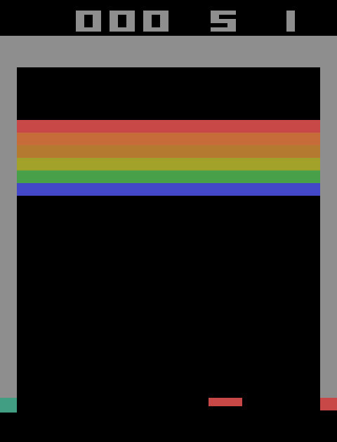
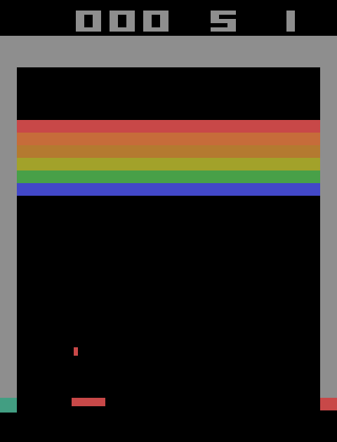
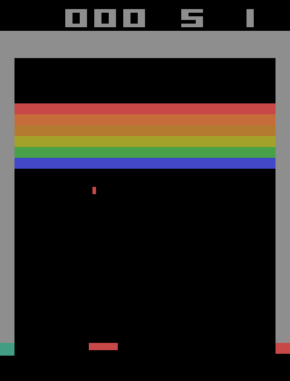

# Assignment 4, Part 1: Prediction sheet

**Eivind Systad Geiran and Trym Andreas Johnsen** · IT3212 · Option 2: Breakout

This is the original prediction sheet (v1), written on 2026-11-12 before any agent was trained; the only prior work was environment inspection without learning (`src/inspect_env.py`, results in `results/inspection/`). It is frozen at git tag `predictions-v1` on *(freeze time)*, later interpretations go in `predictions/annotations.md`, dated and keyed to the IDs below, and AI assistance is recorded in `AI_RECORD.md`.

**TODO before submission:** v1 candidate. Freeze at git tag `predictions-v1` after team review and fill in the freeze time. **TODO:** record Trym's review before the freeze.

## 0. Provisional setup

This is our current interpretation. Part 2 may change details. Any change is recorded as an annotation.

| Item              | Provisional choice                                                                                                                                                                                                                                                                                                                                                                                                                                                                                  |
| ----------------- | --------------------------------------------------------------------------------------------------------------------------------------------------------------------------------------------------------------------------------------------------------------------------------------------------------------------------------------------------------------------------------------------------------------------------------------------------------------------------------------------------- |
| Agents            | Tabular one-step Q-learning (ε-greedy) and clipped PPO (small MLP actor-critic)                                                                                                                                                                                                                                                                                                                                                                                                                     |
| State             | Both see the same compact RAM features. In play: ball y (8 bins), ball direction (dx, dy), bricks hit (0/1), a coarse paddle zone (left/centre/right), and signed horizontal error Δx = ball x − paddle centre. Δx uses 11 non-uniform bins with boundaries −24, −16, −12, −8, −4, 4, 8, 12, 16 and 24 px, giving fine resolution near the paddle edge and coarse tails. Before launch, the state uses the 8-bin paddle position. About 2,100 cells. PPO gets the same bin indices scaled to [0, 1] |
| Episode           | One life from a fresh game, after 0–30 random paddle moves drawn from the episode seed                                                                                                                                                                                                                                                                                                                                                                                                              |
| Outcomes          | **Success:** 2 bricks hit (terminal, reward +1). **Failure:** ball lost (reward 0). **Timeout:** 2,000 agent steps, reported separately                                                                                                                                                                                                                                                                                                                                                             |
| Settings          | **A:** sticky actions off (deterministic). **B:** sticky probability 0.25. **C:** B plus a step penalty c = 0.001. **D:** B agents evaluated with the 12 px paddle (difficulty 1) instead of 16 px                                                                                                                                                                                                                                                                                                  |
| Budget            | Same for both agents, counted in agent steps (1 step = 4 frames). Provisionally 500k steps per run. **Small budget** = the first 10%                                                                                                                                                                                                                                                                                                                                                                |
| Defaults          | γ = 0.99 for both. Q-learning: α = 0.1, ε falls linearly from 1.0 to 0.05 over the first half. PPO: learning rate 3·10⁻⁴, entropy 0.01, 4 epochs, clip 0.2, GAE λ = 0.95. Both get the same tuning allowance                                                                                                                                                                                                                                                                                        |
| Evaluation        | Separate evaluation seeds. 200 episodes every 10% of the budget, with no updates. Primary policy: greedy Q (ties broken at random) and most-probable PPO action. Sampled PPO is reported separately                                                                                                                                                                                                                                                                                                 |
| Seeds             | At least 5 training seeds per agent, the same list for both                                                                                                                                                                                                                                                                                                                                                                                                                                         |
| **Decision rule** | Each metric is computed per training seed. **Supported:** the mean difference is in the predicted direction and larger than the pooled between-seed SD. **Contradicted:** larger than the pooled SD in the opposite direction. **Inconclusive:** otherwise                                                                                                                                                                                                                                          |

Inspection facts used below: random play reaches 2 bricks in 1% (A) and 4.5% (B) of lives, with a median of 27 steps. The tracking rule reaches 2 bricks in 100% (A) and 89% (B) of lives. In A, different seeds give identical trajectories for the same actions.

## 1. Predictions

### P1. Which agent improves fastest with a small interaction budget?
- **Prediction:** PPO. At 10% of the budget, PPO's evaluation success rate is higher than Q-learning's in both A and B.
- **Why:** Success mainly requires keeping the horizontal error between the ball and paddle small. The relative-error representation exposes that geometry to both agents, but the Q-table still learns each combination of error, height, direction and paddle zone separately and propagates the terminal reward only one visited transition at a time. PPO can share what it learns between neighbouring error and height bins, while GAE distributes the delayed success signal across earlier steps in a rollout. Q-learning can learn from exploratory transitions towards its greedy target, but we expect PPO's parameter sharing to matter more within the small budget.
- **Test:** In A and B, evaluation success rate at 10% of the budget, plus the area under the success curve over that first 10%.
- **Contradicted if:** Q-learning's success rate at 10% is higher by more than the pooled seed SD in A or B.

### P2. Which agent shows the largest performance variation across seeds?
- **Prediction:** PPO. At the full budget, its between-seed SD of evaluation success rate is at least 1.5 times Q-learning's in both A and B.
- **Why:** PPO's result depends on network initialisation, sampled actions, rollout composition and stochastic gradient updates. With a sparse terminal reward, an early lucky success can update the shared network across many states and change which trajectories that seed collects next. This can amplify an early difference between seeds. Q-learning also depends on discovering the reward, and a partly filled table can produce brittle greedy behaviour. However, its updates remain local to visited state-action pairs, and with the compact relative-error state, persistent ε-exploration and 500k interactions, we expect repeated visits to average out more of this variation.
- **Test:** For each setting, compute the SD and range of final evaluation success rate across at least five trained agents. Classify A and B separately. The prediction is supported in a setting if SD_PPO ≥ 1.5 × SD_Q, contradicted if SD_Q ≥ 1.5 × SD_PPO, and inconclusive otherwise. The overall result is supported or contradicted only if A and B agree; otherwise it is mixed. Because an SD from five seeds is noisy, we also report every seed and the range.

### P3. How will stochastic transitions change the routes agents learn?
In Breakout, a route is how the paddle moves relative to the ball.

- **Prediction:** Compared with agents trained in A, agents trained in B (a) succeed less often, (b) are already under the ball earlier when it comes down, and (c) change effective paddle direction less often. This holds for both algorithms.
- **Why:** With probability 0.25 the previous action is repeated, so a last-moment correction can fail and rapid left-right switching is unreliable. A paddle that is already under the falling ball is robust to that. In A exact timing always works, so nothing pushes an agent to be early. Even the tracking rule drops from 100% to 89% success, so B is harder for a sensible policy too.
- **Test:** In evaluation, per seed: success rate; mean |ball x − paddle centre| while the ball is falling in the lower field (ball y ≥ 150); and the share of steps whose requested movement category differs from the previous step. The categories are LEFT, RIGHT and STATIONARY, with NOOP and FIRE grouped as STATIONARY while the ball is in play. We also record changes in observed paddle direction, because sticky actions can make executed movement differ from the requested action. A vs B, per agent.
- **Contradicted if:** B agents are not closer to the ball in the lower field, or they change requested and observed movement direction at least as often as A agents.

### P4. How does a step penalty change success rate and episode length?
- **Prediction:** With c = 0.001 per step (C vs B): (a) failed episodes are shorter in C, for both agents; (b) PPO's success rate is lower in C; (c) Q-learning's success rate changes little (inconclusive under our rule); (d) the median successful episode is at least 5% shorter in C.
- **Why:** Until an agent succeeds, every observed reward in C is negative, and the quickest way to stop accumulating penalties is to lose the ball. This gives a dense early learning signal towards short episodes, even if deliberate failure is not the reward-optimal final policy. Because γ = 0.99, the relevant comparison uses discounted returns rather than the undiscounted shortcut c × (success length − failure length) > 1. We expect the terminal +1 to outweigh c = 0.001 for ordinary successful K = 2 trajectories, but we will verify this from their observed lengths before interpreting a success-rate drop as an optimisation effect rather than optimal reward-seeking. PPO updates directly from its current trajectories and may settle into short failures. In a zero-initialised Q-table, tried actions become negative while untried actions remain at zero, which may partly oppose this effect.
- **Test:** Success and failure rates (not returns, which use different rewards), and median lengths of failed and of successful episodes. B vs C, per agent.
- **Contradicted if:** failed episodes are not shorter in C, or PPO's success rate in C is at least as high as in B.

### P5. Will the agent with the highest training return also perform best in evaluation?
- **Prediction:** Not reliably. In at least one of A, B and C, the order by training return and the order by evaluation success differ. Q-learning's evaluation success exceeds its training success by more than PPO's does.
- **Why:** Q-learning trains with ε-greedy actions, and the random actions lose balls, so its training return understates its greedy policy. The cliff-walking example in Sutton & Barto shows the same effect: the online return of Q-learning is lower than its greedy policy deserves. PPO's training return comes from its own sampled policy, so evaluating its most probable action changes less. It can even hurt, if the sampling was doing useful work.
- **Test:** Per seed: success rate over the last 10% of training episodes against the final evaluation success rate. In each of A, B and C, rank the two agents by mean final training return and by mean evaluation success.
- **Contradicted if:** the two rankings agree in all three settings, and Q-learning's evaluation-minus-training gap is not larger than PPO's.

### P6. Which agent would we initially recommend, and what would change our mind?
- **Prediction:** For repeated operation under uncertainty we initially recommend PPO because we expect it to learn faster (P1) and lose less performance after the paddle change (P7), but P2 makes this recommendation provisional: we expect greater variation between PPO seeds. For a quick classroom demonstration we expect tabular Q-learning to be better because its table can be inspected directly and each run is cheap.
- **We would change our mind if:**
    1. Q-learning's failure rate in B is lower than PPO's by more than the pooled seed SD at the full budget.
    2. PPO's worst seed is worse than Q-learning's worst seed in B. Reliability matters more than the mean.
    3. At equal wall-clock time, Q-learning is ahead because PPO's cost per step is much higher.
    4. P7 is contradicted.

### P7 (extra). What survives the change to a narrower paddle (Setting D)?
- **Prediction:** Both B agents succeed less often with the 12 px paddle, but PPO loses fewer percentage points than Q-learning.
- **Why:** The relative-error feature keeps the same meaning in D, but the safe catch interval becomes narrower: an offset that is safe for the 16 px paddle can miss the 12 px paddle. Neither agent is told the paddle width. We expect Q-learning to accept more edge states that succeeded during training, while PPO's stochastic training may favour a larger centring margin. The tracking rule's drop from 89% to 72% shows that the change is difficult even for a sensible fixed policy.
- **Test:** Success in B minus success in D for the same trained agents, per seed.
- **Contradicted if:** Q-learning's drop is smaller than PPO's by more than the pooled seed SD.

## 2. States where we expect the approaches to differ

*Examples of S1, S2 and S3 (left to right), captured during inspection with the tracking rule.*

The states below are identified from the raw RAM trace, even when several raw states map to the same agent observation. For every occurrence we log the binned observation, chosen action, Q-values or policy probabilities, raw ball and paddle positions, and observed transition. This lets us test both the policy prediction and any limitation caused by state aggregation. Part 4 uses the same logs.

### S1. Ball not launched
*Definition:* ball not in play (RAM bytes 99 and 101 are 0), any paddle position. Only FIRE makes progress.

- **Q-learning:** FIRE in the paddle positions that are common at launch (central bins). In rarely visited edge bins the values are still tied near zero, so the launch is delayed.
- **PPO:** FIRE is the most probable action in every paddle position, with P(FIRE) > 0.9.
- **Why:** Every episode starts here, but the random start moves mostly leave the paddle near the centre. The table learns each cell separately, while the network can generalise "ball not in play → FIRE" across paddle positions.
- **Contradicted if:** Q-learning's greedy action is FIRE in all 8 paddle bins for every seed, or PPO's P(FIRE) < 0.5 in any bin. We also compare the number of steps from the start to the launch.

### S2. Ball falling at the paddle edge
*Definition:* ball falling (dy > 0), ball y ≥ 165, and ball x over the paddle's outer 4 px (4–8 px from the paddle centre).

- **Q-learning:** a stationary action, either NOOP or FIRE. It stays because the 16 px paddle can catch the ball at this offset.
- **PPO:** moves towards the ball, centring the paddle under it.
- **Why:** Q-learning's target assumes greedy future requested actions, so it may value an edge catch that succeeds when later actions are controlled. PPO updates under its sampled policy, so its own future action variability can make a centring margin valuable. This resembles the off-policy/on-policy contrast in cliff walking (Sutton & Barto, Example 6.6), but sticky transitions affect both algorithms and are not ignored by Q-learning. The previous executed sticky action is not observed, so the state remains partially observable; the predicted difference is a hypothesis, not a necessary consequence of the algorithms.
- **Contradicted if:** at ball contact, Q-learning's mean |ball x − paddle centre| is not larger than PPO's, or PPO's most probable movement category is STATIONARY in most S2 cells and seeds.

### S3. Ball rising in mid-field
*Definition:* ball rising (dy < 0), 100 ≤ ball y ≤ 150, 50 ≤ ball x ≤ 110. The next paddle contact is many steps away, so the action matters little for now.

- **Q-learning:** no stable preference. The greedy action changes between checkpoints and seeds, and often between consecutive steps.
- **PPO:** a stable choice, typically moving the paddle towards the ball's x position. Consecutive actions rarely switch.
- **Why:** The four Q-values are almost equal here, so small estimation errors decide the argmax, and a table has nothing to smooth them with. PPO's network shares parameters with nearby states where the action does matter, so its preference here follows those.
- **Contradicted if:** Q-learning's movement-category switch rate in S3 is not higher than PPO's, or Q-learning's seeds agree on the greedy movement category in S3 cells as often as PPO's seeds (agreement: at least 4 of 5 seeds choose the same category).

## 3. Change policy

This sheet is not edited after submission. When our interpretation changes, we add a dated entry to `predictions/annotations.md`. The entry names the prediction ID and says what changed and why. Results are compared with this original text.

## References

- Machado, M. C. et al. (2018). Revisiting the Arcade Learning Environment. *JAIR* 61. (Sticky actions, p = 0.25.)
- Schulman, J. et al. (2017). Proximal Policy Optimization Algorithms. arXiv:1707.06347.
- Sutton, R. S. and Barto, A. G. (2018). *Reinforcement Learning: An Introduction*, 2nd ed. (Q-learning; Example 6.6, cliff walking.)
