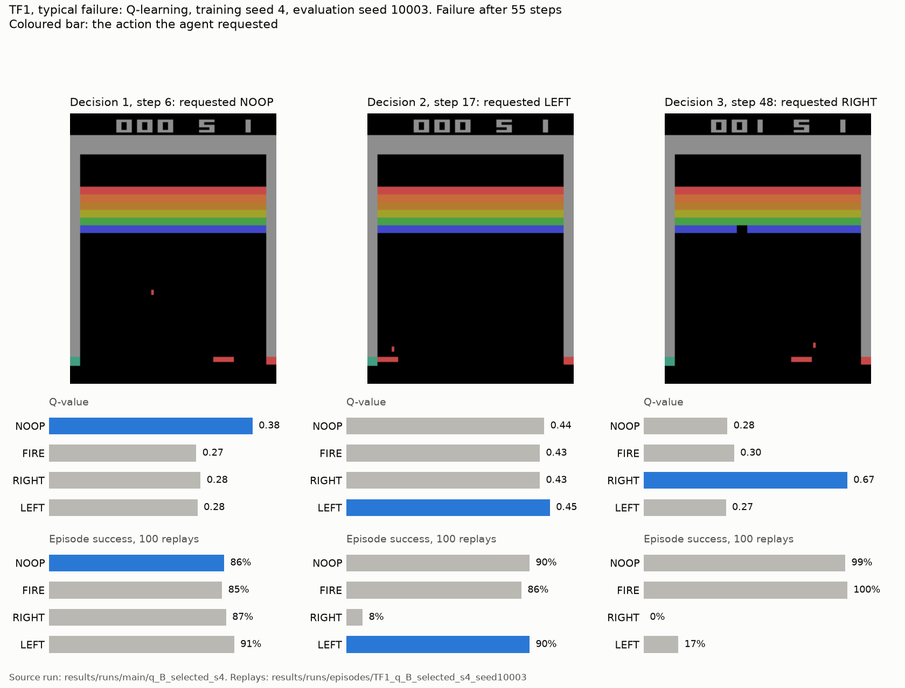

# Evidence brief: Q-learning and PPO on one-life Breakout

**Eivind Systad Geiran and Trym Andreas Johnsen** · IT3212 Assignment 4 · Option 2: Breakout

Draft of 17 November 2026. The prediction sheet (`predictions/predictions_v1.md`)
was submitted before any agent was trained. Its verdicts are in
`predictions/annotations.md`, the run records under `results/runs/`.

## 1. Setup and comparison rules

An episode is one life of ALE Breakout. It succeeds when two bricks are hit,
fails when the ball is lost, and times out after 2,000 agent steps. Both agents
see the same state: binned ball height, ball direction, paddle zone and the
horizontal distance from ball to paddle, 4,760 cells in all. Q-learning uses
the cell as its table index; PPO receives the same bins as a vector.

*Table 1. Comparison rules. Sources: `plans/part2_3_plan.md`, `results/selected_config.json`, `results/logs/`.*

| Rule | Choice |
| --- | --- |
| Interaction budget | 500,000 agent steps per run for both agents, fixed in the sheet. PPO's steps are counted over its 8 parallel environments |
| Training seeds | 0–9 in Part 2 and 0–4 in Part 3, the same list for both agents |
| Evaluation | Seeds 10,000–10,199: 200 episodes at 0, 5, 10, 20, …, 100% of the budget, no updates |
| Evaluation policy | Greedy Q-values with random tie-breaks; PPO's most probable action. Sampled PPO actions are reported separately |
| Tuning allowance | 6 configurations × 3 seeds × 500,000 steps per agent in Setting B, on seeds 100–102 and evaluation seeds 20,000–20,199 |
| Selected configuration | Q-learning: α 0.3, ε from 1 to 0.01 over the first half, γ 0.99. PPO: learning rate 1·10⁻³, entropy 0.01, 4 epochs, γ 0.99 |
| Hardware | Apple M4, 8 runs in parallel, CPU only. Runtimes in Table 2 are training time without evaluation |

The budget is large enough for both agents to solve Setting A (Table 2), so
differences in the other settings are not caused by a budget that stops one
agent early. Equal interactions were not equal computation: PPO needed 8 to 22%
more training time in A and B.

## 2. Settings A to D

*Table 2. Final evaluation, 10 trained agents per row, mean ± SD between seeds. Success, failure and timeout sum to 100%. Mean return equals the success rate in A and B; in C it includes the step penalty and is not compared with them. Source: `results/analysis/main/summary.md` (runs in `sources.txt` there).*

| Setting | Agent | Success % | Range over seeds | Failure % | Timeout % | Mean return | Median steps, success | Median steps, failure | Training time (s) |
| --- | --- | --- | --- | --- | --- | --- | --- | --- | --- |
| A | Q-learning | 100.0 ± 0.0 | 100.0–100.0 | 0.0 ± 0.0 | 0.0 ± 0.0 | 1.000 | 68.0 | – | 307 ± 18 |
| A | PPO | 99.4 ± 2.1 | 93.5–100.0 | 0.7 ± 2.1 | 0.0 ± 0.0 | 0.994 | 67.5 | 25.0 | 375 ± 10 |
| B | Q-learning | 75.9 ± 16.7 | 46.0–95.0 | 20.8 ± 12.9 | 3.3 ± 10.4 | 0.759 | 73.8 | 50.9 | 353 ± 3 |
| B | PPO | 87.8 ± 17.5 | 39.0–97.0 | 11.5 ± 17.5 | 0.7 ± 2.2 | 0.878 | 72.1 | 50.2 | 383 ± 9 |
| C | Q-learning | 79.1 ± 21.8 | 20.5–93.5 | 20.9 ± 21.8 | 0.0 ± 0.0 | 0.721 | 72.2 | 53.8 | 359 ± 3 |
| C | PPO | 93.7 ± 3.6 | 87.5–98.0 | 4.9 ± 1.9 | 1.4 ± 3.0 | 0.839 | 70.4 | 51.6 | 349 ± 54 |

Sampled PPO actions give 97.5 ± 3.7% in A, 85.6 ± 19.1% in B and 91.7 ± 2.9%
in C.

*Figure 1. Evaluation success against environment interactions in A, B and C. 200 evaluation episodes per point, unsmoothed. Thick line: mean over 10 seeds; band: ± 1 SD; thin lines: single seeds. Source: `results/analysis/main/sources.txt`.*

**A, efficiency.** Both agents solve the deterministic game. Neither is
measurably faster early: at 10% of the budget PPO has 16.6% and Q-learning
17.4% (pooled SD 25.5). Q-learning reaches 99.8% at 200,000 steps while it
still explores, then falls to 87–90% between 350,000 and 450,000 steps before
it ends at 100%. PPO rises more slowly and steadily. A Q-learning agent stopped
at an arbitrary point is therefore less dependable than its final score shows.

**B, uncertainty.** Sticky actions cost Q-learning 24.1 points (pooled SD 11.8)
and PPO 11.6 (12.4). PPO ends 11.9 points above Q-learning, which is less than
the variation between seeds (pooled SD 17.1). Each mean hides one trained
agent: PPO seed 6 succeeds in 39%, and Q-learning seed 1 never launches the
ball in 66 of 200 episodes.

**C, incentives.** The step penalty did not produce the behaviour it was meant
to encourage. Successful episodes became 2% shorter for both agents, not the
5% we required, and success did not fall. We compare outcome rates only.

**D, transfer.** The B agents were evaluated on a wall with a 32 px gap and,
separately, with a 12 px paddle.

*Table 3. Agents trained in B, evaluated without further training. Source: `results/analysis/transfer/summary.md`.*

| Agent | B, original | D, gap layout | Range in D | 12 px paddle |
| --- | --- | --- | --- | --- |
| Q-learning | 75.9 ± 16.7 | 51.5 ± 16.5 | 15.0–68.5 | 53.4 ± 9.3 |
| PPO | 87.8 ± 17.5 | 83.4 ± 27.8 | 24.0–99.5 | 68.9 ± 21.6 |

Q-learning loses 24.5 points on the new layout (pooled SD 16.6), PPO 4.4
(23.2). The state gives neither agent a meaningful way to generalise: it holds
no brick positions and assumes a 16 px paddle. The gap changes where the ball
comes back from, so the agents meet cells they visited rarely. A table has
nothing learned in such cells; PPO's network interpolates from neighbouring
ones. That fits the result but was not tested directly, and PPO's range in D
(24.0–99.5%) shows that interpolation is no guarantee.

## 3. Mechanisms

One factor changes at a time in Setting B; every other value is the selected
configuration. Five seeds each.

*Table 4. Final greedy success in B, mean ± SD over 5 seeds. Bold: the selected value, taken from the Part 2 runs with seeds 0–4. Source: `results/analysis/mechanisms/summary.md`.*

| Investigation | Agent | Values and success % |
| --- | --- | --- |
| Exploration | Q-learning | ε 1 → 0.05 over half: 74.2 ± 6.9 · **1 → 0.01 over half: 67.2 ± 18.4** · constant 0.1: 47.6 ± 36.4 · 1 → 0.01 over 10%: 58.7 ± 35.7 |
| Planning horizon | Q-learning | γ 0.9: 86.1 ± 4.8 · **0.99: 67.2 ± 18.4** · 0.999: 64.8 ± 39.2 |
| Planning horizon | PPO | γ 0.9: 10.5 ± 9.3 · **0.99: 94.3 ± 2.6** · 0.999: 94.8 ± 6.1 |
| Policy exploration | PPO | entropy 0: 63.4 ± 40.1 · **0.01: 94.3 ± 2.6** · 0.05: 93.1 ± 4.9 |
| Update size | Q-learning | α 0.02: 39.3 ± 15.2 · 0.1: 86.4 ± 10.9 · **0.3: 67.2 ± 18.4** · 0.5: 67.2 ± 9.6 |
| Update size | PPO | 3·10⁻⁵: 0.0 ± 0.0 · 3·10⁻⁴: 86.7 ± 10.0 · **1·10⁻³: 94.3 ± 2.6** · 3·10⁻³: 89.0 ± 11.1 |
| Data reuse | PPO | 1 epoch: 69.4 ± 39.6 · **4: 94.3 ± 2.6** · 10: 91.2 ± 2.9 |

- **Exploration.** Schedules with little early exploration (constant 0.1,
  decay over the first 10%) leave single agents that never launch the ball:
  20–25% timeouts. Random actions during training hid a greedy policy that
  waits.
- **Planning horizon.** Success arrives about 70 steps after launch. With
  γ 0.9 PPO's most probable action often never launches (65% timeouts), yet its
  sampled policy succeeds in 52%. Q-learning does best with γ 0.9.
- **Policy exploration.** Without the entropy term PPO depends on the seed
  (19.5–94.0%).
- **Update size.** Too small is the clear failure for both. PPO at 3·10⁻⁵ times
  out in every greedy episode.
- **Data reuse.** One epoch learns too little from each rollout; ten adds
  nothing over four.

Tuning chose α 0.3 on three seeds, but on seeds 0–4 α 0.1 scores 19.2 points
higher (pooled SD 15.1). The Part 2 comparison therefore uses a Q-learning
configuration that is probably not its best, and the PPO lead in B (11.9
points) is smaller than this difference.

**A prediction revisited.** S2 predicted that with the ball falling 4–8 px
from the paddle centre, Q-learning would stay still and PPO would move towards
the ball. The result is the reverse: Q-learning stays still in 43% of such
observations, PPO in 61%. The case does not fit our explanation, which assumed
that the action decides the catch. The competing explanation is that it does
not. The diagnostic experiment forced each action for one step from 3,733
saved S2 states, 20 times each with new noise.

*Table 5. Ball caught after one forced action, mean ± SD over 10 seeds. The question and decision rule were committed before the run. Source: `results/analysis/diagnostic/summary.md`.*

| Agent | Stay still | Towards the ball | Away | Still − towards (pooled SD) |
| --- | --- | --- | --- | --- |
| Q-learning | 96.0 ± 3.3 | 92.1 ± 6.4 | 93.4 ± 6.1 | +3.9 (5.1) |
| PPO | 98.9 ± 0.8 | 98.1 ± 1.6 | 97.0 ± 2.1 | +0.8 (1.2) |

The competing explanation holds. The ball is caught in at least 92% of the
replays whichever action is forced, so the reversed preference is a choice
between near-equal actions.

## 4. What the aggregate scores hide

Ten episodes were taken from the final evaluation in B by a rule fixed before
the selection was run. Typical episodes are closest to the median length in
the most common 10-step range of their outcome (Figure 2). Surprising
successes have the lowest value estimate at launch; surprising failures the
highest estimate over their last five steps. From every step of each episode,
all four actions were replayed 20 times with new noise. The three steps where
the action changes the success rate most were replayed 100 times per action.

*Figure 2. Episode length by outcome and algorithm, 2,000 episodes each. Dark bar: most common range. Labels: the selected episodes. Source: `results/analysis/episodes/sources.txt`.*

*Table 6. The ten episodes. Start: successes in 100 replays from the first step. The four-row annotation of every decision is in `results/analysis/episodes/decisions.md`, the videos in `results/videos/episodes/`.*

| ID | Agent (seed) | Outcome, steps | Start | What decided it |
| --- | --- | --- | --- | --- |
| TS1 | Q-learning (4) | success, 74 | 77 | Two decisions that matter, both chosen well |
| TS2 | PPO (1) | success, 71 | 98 | One decision that matters, chosen well |
| TS3 | PPO (3) | success, 71 | 99 | One decision that matters, chosen well |
| TF1 | Q-learning (4) | failure, 55 | 72 | Poor action at step 48: RIGHT 0%, staying still 99–100% |
| TF2 | PPO (9) | failure, 53 | 96 | Unlucky: the only saving action was requested at step 47, the paddle did not move |
| TF3 | Q-learning (1) | failure, 55 | 69 | Poor actions at steps 34 and 42: 0% against 98% |
| SS1 | Q-learning (2) | success, 96 | 93 | Poor action at step 22 (30% against 74%), success all the same |
| SS2 | PPO (9) | success, 72 | 96 | Two decisions that matter, both chosen well |
| SF1 | Q-learning (1) | failure, 53 | 65 | Poor actions at steps 32 and 40: 0% against 98% |
| SF2 | PPO (9) | failure, 71 | 97 | Unlucky in the same way as TF2, at step 63 |

*Figure 3. The three annotated decisions of TF1. At step 48 the highest Q-value belongs to the one action that never succeeds. Source: `results/runs/episodes/TF1_q_B_selected_s4_seed10003`.*

The failure rate treats all failures alike. The episodes show two kinds. The
three Q-learning failures each contain an action that alone loses the episode
while another action succeeds in 98–100% of the replays. The two PPO failures
are unlucky outcomes: the agent requested the only action that saves the ball,
and the sticky noise held the paddle for that step. The agent had waited until
the last step to move, so the luck met a habit that leaves no margin.

This is a limitation of the tables, and the episodes have their own. Five
failures are few. Both PPO failures come from seed 9, while seed 6 produces
122 of PPO's 230 failures and was not selected. The 11.5% failure rate of PPO
is mostly one trained agent, and we have not inspected why it fails.

## 5. Recommendations

*Table 7. One row per situation.*

| | Rapid classroom demonstration | Repeated operation in uncertainty | Operation after an environment change |
| --- | --- | --- | --- |
| Approach | Q-learning, selected configuration, in the deterministic setting | PPO, selected configuration, with every trained agent evaluated before use | None adequately supported; PPO is the less affected |
| Evidence 1 | 100.0 ± 0.0% in A on all 10 seeds | Failures in B: PPO 11.5%, Q-learning 20.8%; in C 4.9 ± 1.9% against 20.9 ± 21.8% | D: PPO −4.4 points, Q-learning −24.5 |
| Evidence 2 | Decisions can be read from four Q-values per state (Figure 3) | Nine of ten PPO agents reach 85.5–97.0% in B | 12 px paddle: both lose about 20 points |
| Observed weakness | Success fell to 87–90% between 350,000 and 450,000 steps before the end | One of ten PPO agents reaches 39% | PPO ranges from 24.0 to 99.5% in D |
| We would change it if | The demonstration includes sticky actions and must be short | Agents cannot be evaluated before use | The state described the layout and the paddle width |
| Further experiment | Budgets of 50,000–200,000 steps in A with 10 seeds, to find the shortest dependable run | 30 seeds per agent, and Q-learning with α 0.1, to estimate how often a poor agent appears | Training on varied layouts and paddle widths, then evaluation on changes not seen in training |

**Rapid classroom demonstration.** Q-learning in Setting A is the only
combination with no failed episode on any seed, and its behaviour can be
explained from the table: Figure 3 shows a wrong decision next to the Q-values
that caused it. Explainable is not the same as correct, and the training time
is no shorter than PPO's by much (307 against 375 s). PPO is the better choice
if the demonstration must show sticky actions.

**Repeated operation in uncertainty.** PPO fails less often in B and C, but in
B the difference is smaller than the variation between seeds, so this is weak
evidence. The sheet named the condition that would change our initial
recommendation of PPO: a worst PPO seed below the worst Q-learning seed. That
happened (39.0% against 46.0%). We therefore recommend PPO only together with
an evaluation of each trained agent on separate seeds, which would have
rejected seed 6. Without that step neither agent is adequately supported where
failures matter.

**Operation after an environment change.** Neither agent is reliable on
conditions it has not seen. PPO keeps more of its success on the gap layout,
but single agents fall to 24%, and both lose about 20 points with the narrower
paddle. The agents had no information about what changed.

## 6. Scope

Specific to this implementation: the hand-made state of 4,760 cells, success
defined as two bricks in one life, a budget of 500,000 steps, sticky actions
as the only source of uncertainty, and Stable-Baselines3 PPO with a small
network. Q-learning's result also depends on α, which our tuning chose poorly.

We believe three observations illustrate broader principles. First, the
variation between training seeds was as large as the difference between the
algorithms, so a comparison from one run per algorithm would have been
decided by the seed. Second, an agent trained with exploration can have a
greedy policy that fails in a way training never showed, as the agents that
never launch the ball did. Third, values stored per state do not carry over
to states that were not visited, while a function over the same features can
interpolate without any assurance that it does so correctly.

Nothing here shows that one algorithm is better in general.
