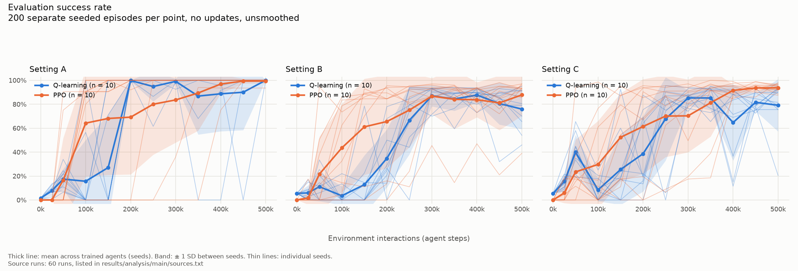
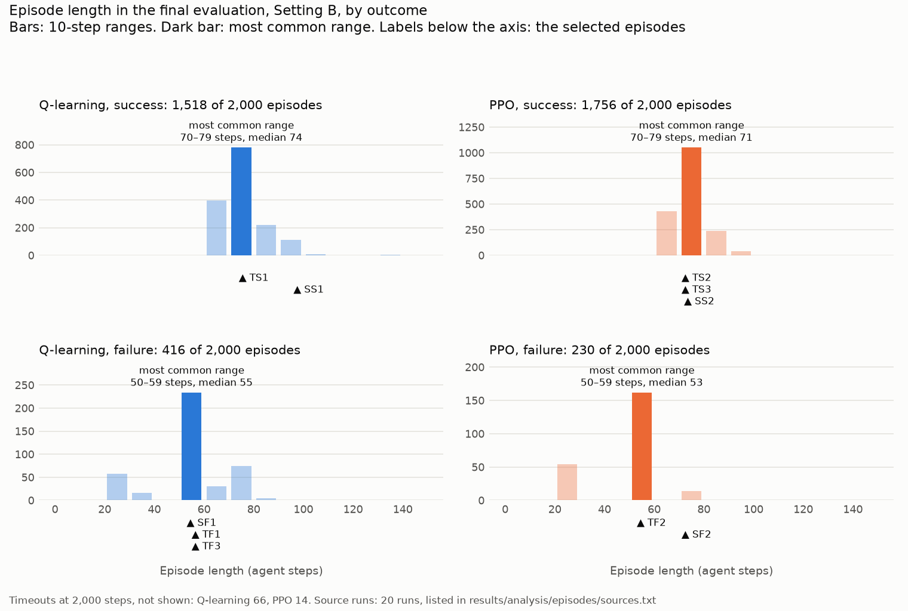

# Evidence brief: Q-learning and PPO on one-life Breakout

**Eivind Systad Geiran and Trym Andreas Johnsen** · IT3212 Assignment 4 · Option 2: Breakout

Drafted 17 November 2026; revised 28 November 2026. Part 1, the prediction sheet
(`predictions/predictions_v1.md`), was submitted before any agent was trained;
its verdicts are in `predictions/annotations.md`. Part 5, the team review, is
in `report/review_record.md`. Run records are under `results/runs/`.

| Assignment requirement | Where it is answered |
| --- | --- |
| Part 2: interaction budget, seeds, evaluation policy, tuning allowance, runtime and hardware | Table 1 |
| Part 2: success, return, failure, episode length by outcome, interactions, runtime, seed variation | Table 2 |
| Part 2: learning curves against interactions, smoothing, evaluation frequency | Figure 1, Table 1 |
| Part 2, D: does the state representation allow generalisation? | Part 2, D; Table 3 |
| Part 3: one factor at a time, at least five seeds | Table 4 |
| Part 3: prediction revisited, case that does not fit, competing explanation, diagnostic | Part 3; Table 5 |
| Part 4: selection rule, ten episodes, three annotated decisions each | Part 4; Tables 6–6a; Figures 2–3; `results/analysis/episodes/decisions.md` |
| Part 4: a limitation of the aggregate results | Part 4, "Poor action or unlucky outcome?" and "Limits of the episodes" |
| Part 5: human review | `report/review_record.md` |
| Part 6: three recommendations with approach, two pieces of evidence, weakness, change condition, further experiment | Table 7; Part 6 |
| Part 6: specific implementation versus broader principle | Part 6, last subsection |
| AI assistance | `AI_RECORD.md` |

## Part 2: Learning settings

### Setup and comparison rules

An episode is one life of ALE Breakout. It succeeds when two bricks are hit,
fails when the ball is lost, and times out after 2,000 agent steps. Both agents
see the same state: binned ball height, direction, brick-hit count, paddle zone
and signed ball-to-paddle error; before launch, paddle position. There are
4,760 cells. Q-learning indexes a table; PPO receives the ordered, scaled bins
and an in-play flag. Neither receives brick positions or paddle width.
The previous executed sticky action is also omitted, leaving partial
observability under sticky transitions.
The sheet's pooled-SD rule is descriptive, not a significance or equivalence test.
B and C use sticky actions (probability 0.25 per emulator frame; four frames
per agent step); C subtracts 0.001 reward per agent step, including the terminal
step.

*Table 1. Comparison rules. Sources: `plans/part2_3_plan.md`, `results/selected_config.json`, `results/logs/`.*

| Rule | Choice |
| --- | --- |
| Interaction budget | 500,000 agent steps per run for both agents, fixed before training using inspection throughput to make repeated runs feasible; not a convergence claim. One step = 4 frames. PPO counts steps across its 8 environments. Random reset moves are excluded |
| Training seeds | 0–9 in Part 2 and 0–4 in Part 3, the same list for both agents |
| Evaluation | Seeds 10,000–10,199: 200 episodes at 0, 5, 10, 20, …, 100% of the budget, no updates |
| Evaluation policy | Greedy Q-values with random tie-breaks; PPO's most probable action. Sampled PPO actions are reported separately |
| Tuning allowance | 6 configurations × 3 seeds × 500,000 steps per agent in Setting B, on seeds 100–102 and evaluation seeds 20,000–20,199 |
| Selected configuration | Q-learning: α 0.3, ε from 1 to 0.01 over the first half, γ 0.99. PPO: learning rate 1·10⁻³, entropy 0.01, 4 epochs, γ 0.99 |
| Hardware | Apple M4, 8 runs in parallel, CPU only. Runtimes in Table 2 are training time without evaluation |

Both nearly solve A; this establishes neither convergence in B nor transfer
sufficiency. Equal interactions did
not mean equal computation: PPO took 8–22% longer in A/B. PPO B seed 6 took 399 s
to train and 696 s to evaluate. Tuning took 2 h 26 min on eight workers
(`results/logs/tune.log`). Inference latency was not benchmarked, so deployment
time is unknown.

### Settings A to D

*Table 2. Final greedy evaluation, 10 trained agents per row, mean ± sample SD between seeds. Lengths are means of per-agent outcome-specific medians, omitting agents with no such outcome. A averages about 33 distinct trajectories per 200 episodes; the training replication unit is the agent, not each evaluation episode. Success, failure and timeout sum to 100%. A/B return equals success rate; C return includes step penalties and is not compared with A/B. Source: `results/analysis/main/summary.md`; runs: `results/analysis/main/sources.txt`.*

| Setting | Agent | Success % | Range over seeds | Failure % | Timeout % | Mean return | Median steps, success | Median steps, failure | Training time (s) |
| --- | --- | --- | --- | --- | --- | --- | --- | --- | --- |
| A | Q-learning | 100.0 ± 0.0 | 100.0–100.0 | 0.0 ± 0.0 | 0.0 ± 0.0 | 1.000 | 68.0 | – | 307 ± 18 |
| A | PPO | 99.4 ± 2.1 | 93.5–100.0 | 0.7 ± 2.1 | 0.0 ± 0.0 | 0.994 | 67.5 | 25.0 | 375 ± 10 |
| B | Q-learning | 75.9 ± 16.7 | 46.0–95.0 | 20.8 ± 12.9 | 3.3 ± 10.4 | 0.759 | 73.8 | 50.9 | 353 ± 3 |
| B | PPO | 87.8 ± 17.5 | 39.0–97.0 | 11.5 ± 17.5 | 0.7 ± 2.2 | 0.878 | 72.1 | 50.2 | 383 ± 9 |
| C | Q-learning | 79.1 ± 21.8 | 20.5–93.5 | 20.9 ± 21.8 | 0.0 ± 0.0 | 0.721 | 72.2 | 53.8 | 359 ± 3 |
| C | PPO | 93.7 ± 3.6 | 87.5–98.0 | 4.9 ± 1.9 | 1.4 ± 3.0 | 0.839 | 70.4 | 51.6 | 349 ± 54 |

Sampled PPO actions give 97.5 ± 3.7% in A, 85.6 ± 19.1% in B and 91.7 ± 2.9%
in C.

*Figure 1. Evaluation success against environment interactions in A, B and C. 200 evaluation episodes per point, unsmoothed. Thick line: mean over 10 seeds; band: ± 1 SD; thin lines: single seeds. Source: `results/analysis/main/sources.txt`.*

**A: How efficiently does each approach learn?** Both agents nearly solve the deterministic game. Early ranking is
unresolved: at 10% of the budget PPO has 16.6% and Q-learning
17.4% (pooled SD 25.5). Q-learning reaches 99.8% at 200,000 steps while it
still explores, then falls to 87–90% between 350,000 and 450,000 steps before
it ends at 100%. PPO rises more slowly and steadily. A Q-learning agent stopped
at an arbitrary point is therefore less dependable than its final score shows.

P2 is formally supported in A: PPO SD 2.1 exceeds 1.5 × Q-learning SD 0.
All variation comes from one PPO agent at 93.5%; the other 19 agents reach
100%. In B, SDs 17.5/16.7 give ratio 1.05: inconclusive. The prediction of
greater PPO variation in both settings is therefore not established.

**B: How does uncertainty affect learning and behaviour?** Sticky actions cost Q-learning 24.1 points (pooled SD 11.8)
and PPO 11.6 (12.4). PPO ends 11.9 points above Q-learning, which is less than
the variation between seeds (pooled SD 17.1). Each mean hides one trained
agent: PPO seed 6 succeeds in 39%, and Q-learning seed 1 never launches the
ball in 66 of 200 episodes.

**C: Does the reward encourage the behaviour we want?** Mean success was
observed to be higher in C than B for Q-learning (79.1% vs 75.9%) and PPO
(93.7% vs 87.8%). Successful episodes were about 2% shorter for both (72.2 vs
73.8 and 70.4 vs 72.1 steps), below our pre-set 5% threshold. These observed
differences do not establish causation. We compare outcome rates and duration;
returns are not comparable because B and C use different reward definitions.

**D: What survives a change in environment?** The B agents were evaluated on a wall with a 32 px gap and,
separately, with a 12 px paddle.

*Table 3. Final B agents, 200 greedy episodes each, no updates or additional training; original training: 500,000 steps per agent (B timings in Table 2). Mean ± SD across 10 agents; lengths as in Table 2. Sources: `results/analysis/transfer/summary.md`, run list `results/analysis/transfer/sources.txt`. The combined D/P7 evaluation batch took 134 s on eight Apple M4 workers (`results/logs/transfer.log`); per-condition evaluation timings were not logged.*

| Setting | Agent | Success % | Range | Failure % | Timeout % | Mean return | Median steps, success / failure |
| --- | --- | --- | --- | --- | --- | --- | --- |
| D, gap | Q-learning | 51.5 ± 16.5 | 15.0–68.5 | 45.2 ± 18.4 | 3.3 ± 10.4 | 0.515 | 61.9 / 52.5 |
| D, gap | PPO | 83.4 ± 27.8 | 24.0–99.5 | 16.0 ± 28.0 | 0.7 ± 2.2 | 0.834 | 60.5 / 43.6 |
| P7, 12 px | Q-learning | 53.4 ± 9.3 | 38.0–68.0 | 43.3 ± 12.8 | 3.3 ± 10.4 | 0.534 | 71.0 / 55.6 |
| P7, 12 px | PPO | 68.9 ± 21.6 | 13.5–91.5 | 30.4 ± 21.5 | 0.7 ± 2.2 | 0.689 | 71.5 / 53.0 |

Q-learning loses 24.5 points on the new layout (pooled SD 16.6), PPO 4.4
(23.2).

**Does the state allow generalisation?** The state omits brick positions and assumes a 16 px paddle, so neither
agent can condition explicitly on the layout or paddle width. It still carries
useful ball direction, height, ball-to-paddle error and paddle-zone information
across layouts. The gap can change the ball's return path and state occupancy;
the claim that it sends agents into rarely visited cells is plausible but not
tested here. A table has no learned values in unseen cells; PPO can interpolate
over the shared features, but the 24.0–99.5% range in D shows this does not
guarantee reliable transfer. Ten training seeds on one altered layout are not
ten independent tests of generalisation to unfamiliar layouts.

## Part 3: Mechanisms

One factor changes at a time in Setting B; every other value is the selected
configuration. Five seeds each.

*Table 4. Final greedy success in B, mean ± SD over seeds 0–4, 500,000 steps each. Only the named factor changes; environment, state, budget, evaluation seeds/policy and remaining hyperparameters stay fixed. Bold values reuse the matched Part 2 agents. Sources: `results/analysis/mechanisms/summary.md`, run list `results/analysis/mechanisms/sources.txt`.*

| Investigation | Agent | Values and success % |
| --- | --- | --- |
| Exploration | Q-learning | ε 1 → 0.05 over half: 74.2 ± 6.9 · **1 → 0.01 over half: 67.2 ± 18.4** · constant 0.1: 47.6 ± 36.4 · 1 → 0.01 over 10%: 58.7 ± 35.7 |
| Planning horizon | Q-learning | γ 0.9: 86.1 ± 4.8 · **0.99: 67.2 ± 18.4** · 0.999: 64.8 ± 39.2 |
| Planning horizon | PPO | γ 0.9: 10.5 ± 9.3 · **0.99: 94.3 ± 2.6** · 0.999: 94.8 ± 6.1 |
| Policy exploration | PPO | entropy 0: 63.4 ± 40.1 · **0.01: 94.3 ± 2.6** · 0.05: 93.1 ± 4.9 |
| Update size | Q-learning | α 0.02: 39.3 ± 15.2 · 0.1: 86.4 ± 10.9 · **0.3: 67.2 ± 18.4** · 0.5: 67.2 ± 9.6 |
| Update size | PPO | 3·10⁻⁵: 0.0 ± 0.0 · 3·10⁻⁴: 86.7 ± 10.0 · **1·10⁻³: 94.3 ± 2.6** · 3·10⁻³: 89.0 ± 11.1 |
| Data reuse | PPO | 1 epoch: 69.4 ± 39.6 · **4: 94.3 ± 2.6** · 10: 91.2 ± 2.9 |

- **Exploration.** Schedules with little early exploration (constant 0.1,
  decay over the first 10%) leave single agents that never launch the ball:
  20–25% timeouts. Random actions during training hid a greedy policy that
  waits.
- **Planning horizon.** Success arrives about 70 steps after launch. With
  γ 0.9 PPO's most probable action often never launches (65% timeouts), yet its
  sampled policy succeeds in 52%. Q-learning does best with γ 0.9.
- **Policy exploration.** Without the entropy term PPO depends on the seed
  (19.5–94.0%).
- **Update size.** Too small is the clear failure for both. PPO at 3·10⁻⁵ times
  out in every greedy episode.
- **Data reuse.** One epoch scores 69.4%, four 94.3%, ten 91.2%. More
  optimisation did not monotonically improve this configuration; this does not
  identify underfitting or overfitting as the cause.

Tuning favoured α 0.3 on seeds 100–102 (83.7% against 53.5% for α 0.1,
both with final ε 0.01). On matched seeds 0–4, changing only α to 0.1 raises
Q-learning from 67.2% to 86.4%; selected PPO scores 94.3%, shrinking its lead
from 27.1 to 7.9 points. α 0.1 wins all five Q pairs, particularly seeds 0/1.
This shows configuration sensitivity, not a best-tuned algorithm ranking.
Retaining the tuning choice avoids selecting a new winner on evaluation data.

**Does the result support the prediction?** S2 predicted that with the ball
falling 4–8 px from the paddle centre, Q-learning would stay still and PPO
would move towards the ball. Q-learning favours stationary in 43% of shared
visits, PPO in 61%; PPO favours towards in 30%. Both predicted majority
preferences are contradicted; this does not mean most Q decisions move towards.

**A case that does not fit.** The majority preferences fail, but this alone
does not show whether centring changes catch probability.

**Competing explanation.** Different first actions may lead to similar catch
rates. Alternatively, effects may depend on the agent and visited state.
These are hypotheses, not established equivalence.

**Diagnostic experiment.** Each action was forced for one step from 3,733
saved S2 states, 20 times each with new noise.

*Table 5. Outcomes after one forced action, mean ± SD over 10 seeds; S = stationary, T = towards, A = away. The greedy policy then continues: catch means the ball rises before loss, success means reaching two bricks. The question and decision rule preceded the run. Sources: `results/analysis/diagnostic/summary.md`, run list `results/analysis/diagnostic/sources.txt`.*

| Agent | Catch S/T/A | Success S/T/A | S − T, catch / success (pooled SD) |
| --- | --- | --- | --- |
| Q-learning | 96.0 ± 3.3 / 92.1 ± 6.4 / 93.4 ± 6.1 | 79.5 ± 12.2 / 71.5 ± 8.4 / 75.3 ± 13.4 | +3.9 (5.1) / +8.0 (10.5) |
| PPO | 98.9 ± 0.8 / 98.1 ± 1.6 / 97.0 ± 2.1 | 89.8 ± 15.7 / 87.5 ± 18.7 / 86.9 ± 17.7 | +0.8 (1.2) / +2.2 (17.3) |

These replays show high immediate catch rates under all three forced actions.
They also continue the agent's greedy policy and record full-episode success.
Both mean outcomes favour STATIONARY, which is weak evidence in that direction,
but the still-versus-towards differences are smaller than pooled SD. The action
effect therefore remains unresolved under the sheet's rule; this is not
evidence of practical equivalence. The mean also hides seed-level changes
(`results/analysis/diagnostic/per_seed.csv`):
Q-learning seeds 2, 6 and 8 lose 17–40 points of episode success after
TOWARDS, while the other seeds do not show the same pattern. The 3,733 tested
states are first S2 states from the agents' own episodes, not a randomized
state sample.

## Part 4: What the aggregate scores hide

**How we selected the episodes.** Ten episodes were taken from the final evaluation in B by a rule fixed before
the selection was run. Typical episodes are closest to the median length in
the most common 10-step range of their outcome (Figure 2). Surprising
successes have the lowest value estimate at launch; surprising failures the
highest estimate over their last five steps. From every step of each episode,
all four actions were replayed 20 times with new noise. The three steps where
the action changes the success rate most were replayed 100 times per action.

*Figure 2. Episode length by outcome and algorithm, 2,000 episodes each. Dark bar: most common range. Labels: the selected episodes. Source: `results/analysis/episodes/sources.txt`.*

*Table 6. The ten episodes. Start: successes in 100 replays from the first step. All 30 decision annotations (state/actions, values/probabilities, transition/outcome, alternatives with conditional 95% Wilson intervals) are in `results/analysis/episodes/decisions.md` / `.pdf`; videos: `results/videos/episodes/`. Intervals concern replay noise, not new training seeds or states. Selection and source runs: `results/analysis/episodes/selection.md`.*

| ID | Agent (seed) | Outcome, steps | Start | What decided it |
| --- | --- | --- | --- | --- |
| TS1 | Q-learning (4) | success, 74 | 77 | Two decisions that matter, both chosen well |
| TS2 | PPO (1) | success, 71 | 98 | One decision that matters, chosen well |
| TS3 | PPO (3) | success, 71 | 99 | One decision that matters, chosen well |
| TF1 | Q-learning (4) | failure, 55 | 72 | Poor action at step 48: RIGHT 0%, staying still 99–100% |
| TF2 | PPO (9) | failure, 53 | 96 | Unlucky: the only saving action was requested at step 47, the paddle did not move |
| TF3 | Q-learning (1) | failure, 55 | 69 | Poor actions at steps 34 and 42: 0% against 98% |
| SS1 | Q-learning (2) | success, 96 | 93 | Poor action at step 22 (30% against 74%), success all the same |
| SS2 | PPO (9) | success, 72 | 96 | Two decisions that matter, both chosen well |
| SF1 | Q-learning (1) | failure, 53 | 65 | Poor actions at steps 32 and 40: 0% against 98% |
| SF2 | PPO (9) | failure, 71 | 97 | Unlucky in the same way as TF2, at step 63 |

*Figure 3. The three annotated decisions of TF1. At step 48 the highest Q-value selects RIGHT: 0 successes in 100 replays, versus 99 for NOOP and 100 for FIRE. Source: `results/runs/episodes/TF1_q_B_selected_s4_seed10003`.*

**Poor action or unlucky outcome?** The failure rate treats all failures
alike. The episodes show two kinds. The
three Q-learning failures each contain a chosen action with 0/100 successful
replays, versus 98–100/100 for an alternative. In the two PPO failures, the
agent requested the only action with nonzero success in the tested replays,
but the paddle did not move that step under sticky noise. Waiting until the
last step to move left little margin. These frequencies are conditional on
the saved states and policies, not guaranteed action outcomes.

**Limits of the episodes.** This is a limitation of the tables, and the
episodes have their own. Five
failures are few. Both selected PPO failures come from seed 9, while seed 6
produces 122 of PPO's 230 failures and was not selected. The prespecified
selection remains unchanged; a separate look at seed 6's existing evaluation
checkpoints (Table 6a) shows that its 39% final success followed a low point of
11% at 250,000 steps. This describes one outlying run, not why it failed or how
often such a seed occurs. At the final checkpoint, 121 of its 122 failures
launch at step 1, none time out, and failure length has a median of 53 steps;
the saved episode rows locate failure after launch but do not show the state
sequence that explains it. Eivind's supplemental GIF of evaluation seed 10001
shows a catch followed by a stationary paddle requesting FIRE. One trajectory
does not establish the cause of all 122 failures; that needs alternative-action
replays. It does not replace the original ten episodes.

*Table 6a. Supplemental, not part of the original ten-episode selection:
PPO seed 6 in B, greedy evaluation on the same 200 fixed seeds at each
checkpoint. Source: `results/analysis/episodes/ppo_seed6.md`.*

| Steps | Success | Failure | Timeout |
| ---: | ---: | ---: | ---: |
| 0 | 0.0% | 0.0% | 100.0% |
| 25,000 | 0.0% | 76.0% | 24.0% |
| 50,000 | 20.5% | 79.5% | 0.0% |
| 100,000 | 14.5% | 85.5% | 0.0% |
| 250,000 | 11.0% | 89.0% | 0.0% |
| 500,000 | 39.0% | 61.0% | 0.0% |

## Part 6: Recommendations

*Table 7. Decisions for the three situations. "Selected" means the exact hyperparameters in Table 1; Q-learning is tabular and PPO uses the 2 × 64 tanh network. Evidence: Tables 2–3 and `results/analysis/episodes/decisions.md`.*

| | Rapid classroom demonstration | Repeated operation in uncertainty | Operation after an environment change |
| --- | --- | --- | --- |
| Approach and configuration | Selected Q-learning, A, 500k steps, greedy table with random tie-breaks | Try selected PPO first, B, 500k steps, most-probable actions, conditional on testing the specific trained agent on fresh episodes before use | No deployment; selected frozen B agents are benchmark candidates only |
| Evidence 1 | Q: 100% on all 10 seeds | B failures: PPO 11.5%, Q 20.8%; C: 4.9% vs 20.9% | D: PPO −4.4 points, Q −24.5 |
| Evidence 2 | Training 307 s vs PPO 375 s on M4; inspect four Q-values per state (Figure 3), but explainability was not measured | 9/10 PPO agents reach 85.5–97.0% in B | 12 px paddle: Q −22.5 points, PPO −18.9 |
| Observed weakness | Q falls to 87–90% late in training | P6 trigger: worst PPO 39%, worst Q 46% | PPO ranges 24.0–99.5% in D |
| We would change it if | A shorter deadline makes success unacceptable, students cannot explain decisions, or sticky actions are required | Fresh validation fails a prospectively chosen reliability requirement; without a validated screen, recommend neither | A candidate meets a prospectively chosen reliability requirement across held-out layouts and widths |
| Further experiment before external use | Matched short-budget demo trial: measure full training/validation time and ask students to explain the same decisions from Q-values or PPO probabilities | Retune both agents on new tuning seeds; compare new training seeds with a prospective acceptance rule and independent evaluation, recording rejection rates and screening cost | Evaluate the frozen candidates on independently designed held-out layouts and widths; report failures per layout and agent, not only a pooled mean |

These follow-ups are proposals before external use, not missing assessed experiments.

**Rapid classroom demonstration.** Selected Q-learning in A has no observed
final failures and shorter training (307 against 375 s). Students can inspect
four Q-values and the chosen action beside the transition (Figure 3). PPO's
four action probabilities are also inspectable: easier understanding was not
measured. At 50k steps neither performs well, and intermediate Q checkpoints
can collapse. A short-budget demo therefore needs its own validation; A's
evidence does not apply when sticky actions are required.

**Repeated operation in uncertainty.** PPO fails less often in B and C, but in
B the difference is smaller than the variation between seeds, so this is weak
evidence. PPO seed 6 also shows why a mean-only recommendation is risky: it
finished at 39% after its 250,000-step evaluation was 11%. The sheet's P6
reversal condition was met: the worst PPO seed scored below the worst
Q-learning seed (39.0% against 46.0%). We therefore withdraw an unconditional
PPO recommendation. Neither observed minimum bounds a future agent's result.
Following the review, PPO is the first candidate to test on fresh episodes
before use. A pass threshold and screening validation remain future decisions;
no successful screening procedure has been established. Without testing the
specific trained agent, neither method is recommended unconditionally when
failures matter.

**Operation after an environment change.** Neither tested agent is adequately
supported for reliable deployment. PPO loses less on this gap layout, but
single agents fall to 24%, and both lose about 20 points with a narrower
paddle. They see ball/paddle geometry but no explicit layout or width. One
altered layout cannot establish reliability across unknown environments.

### Specific to this implementation, and broader principles

Specific to this implementation: the hand-made state of 4,760 cells, success
defined as two bricks in one life, a budget of 500,000 steps, sticky actions
as the only source of uncertainty, and Stable-Baselines3 PPO with a small
network. The five-seed mechanism comparison raises uncertainty about the
selected Q-learning α; it does not establish which value is best.

These runs illustrate several principles within this task. First, the
variation between training seeds was as large as the difference between the
algorithms, so a comparison from one run per algorithm could have been decided
by the seed. Second, an agent trained with exploration can have a
greedy policy that fails in a way training never showed, as the agents that
never launch the ball did. Third, values stored per state do not carry over
to states that were not visited, while a function over the same features can
interpolate without any assurance that it does so correctly.

Nothing here shows that one algorithm is better in general, or that the
results hold for other games or state designs.
